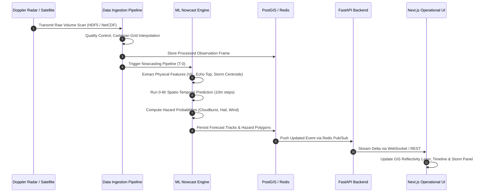

# STORMNET — Comprehensive System Architecture
**Project:** STORMNET — AI-Powered Convective Nowcasting Platform  
**Problem Statement:** SIH26084 — Convective Scale Nowcasting for Thunderstorms, Hail & Cloudbursts (0–6 hr)  
**File Reference:** `docs/architecture/system-architecture.md`  
**Classification:** Operational Weather Intelligence Platform Specification

---

## 1. Architectural Philosophy & Layered Topology

STORMNET is engineered as a decoupled, multi-tier asynchronous architecture designed to handle high-throughput spatial raster streams (Doppler Radar sweeps every 10–12 minutes, INSAT Rapid Scan every 15 minutes) and deliver low-latency nowcasts (under 90 seconds from observation ingest to client alert).

```
+-----------------------------------------------------------------------------------+
|                            PRESENTATION TIER (Next.js)                            |
| MapLibre GL Convective Map | Timeline Scrubber | Storm Panel | Alert Banners      |
+-----------------------------------------------------------------------------------+
                                         ▲
                                         │ REST API / WebSocket (GeoJSON, GeoTIFF)
                                         ▼
+-----------------------------------------------------------------------------------+
|                        APPLICATION & API TIER (FastAPI)                           |
| - Routers: /storms, /forecasts, /hazards, /alerts, /locations                     |
| - Services: StormTrackingService, HazardPredictionService, CapAlertService        |
| - Repositories: PostGIS Spatial Queries, Redis Key-Value & PubSub Cache           |
+-----------------------------------------------------------------------------------+
       ▲                                 ▲                                 ▲
       │ Query / State                   │ ML Task Trigger                 │ Data Feed
       ▼                                 ▼                                 ▼
+---------------------+        +---------------------+        +---------------------+
|   DATA STORE TIER   |        |  MACHINE LEARNING   |        | DATA INGESTION TIER |
| PostgreSQL 16 +     |        | INFERENCE ENGINE    |        | (Future Adapters)   |
| PostGIS 3.4         |        | - Spatio-Temporal   |        | - IMD DWR Radar     |
| (Spatial Vectors,   |        |   Nowcast (U-Net /  |        | - INSAT-3D/3DR      |
|  Tracks, Forecasts, |        |   ConvLSTM)         |        | - IITM Lightning    |
|  Hazard History)    |        | - TITAN / SCIT Cell |        | - AWS Surface Nets  |
| Redis 7 (Cache)     |        |   Tracking Engine   |        | - NWP Blend (NCUM)  |
+---------------------+        +---------------------+        +---------------------+
```

---

## 2. Component Layer Breakdown

### 2.1 Presentation Tier (`apps/web`)
- **Next.js (App Router):** Server-rendered application shell delivering sub-second First Contentful Paint, hosting dynamic client components for spatial rendering.
- **MapLibre GL / Canvas Renderer:** Vector tile and raster rendering engine capable of displaying multi-layer convective data:
  - Doppler Radar reflectivity ($Z$) heatmaps (15 to 70+ dBZ).
  - Algorithmic convective cell bounding polygons.
  - Storm motion trajectory vectors with 15, 30, 45, and 60-minute extrapolated future centroids.
- **Matte Cream Design Tokens:** Custom design tokens ([design-tokens.md](file:///e:/project/SIH%20project%202%20Stormnet/docs/design/design-tokens.md)) delivering a calm, government-intelligence visual tone tailored for long command-center shifts.

### 2.2 Application & API Tier (`apps/api`)
- **FastAPI Layer:** Fully asynchronous Python API implementing strict separation of concerns:
  - **Routers:** Validate HTTP payloads and map URL paths (`/api/v1/*`).
  - **Services:** Execute operational workflows (e.g., cell risk scoring, CAP advisory generation).
  - **Repositories:** Perform spatial queries against PostGIS using parameterized queries and SQLAlchemy 2.0 ORM.
  - **Schemas (Pydantic v2):** Strongly typed data transfer contracts ensuring cross-language type safety with the TypeScript frontend.

### 2.3 Data Store Tier (PostgreSQL + PostGIS & Redis)
- **PostgreSQL 16 + PostGIS 3.4:** Primary system of record for:
  - Convective storm cells and centroid coordinates (`geometry(Point, 4326)`).
  - Convective polygon contours (`geometry(Polygon, 4326)`).
  - Extrapolated track vectors (`geometry(LineString, 4326)`).
  - Spatial indexes (`GIST`) enabling millisecond spatial intersects with administrative district boundaries.
- **Redis 7:**
  - In-memory cache for recent radar frames ($T-60\text{m}$ to $T-0$) to eliminate duplicate database disk reads.
  - Pub/Sub bus for pushing real-time hazard alerts to connected client WebSocket sessions.

### 2.4 Machine Learning & Nowcasting Engine (`ml/`)
- **Preprocessing Pipeline:** Converts raw polar radar sweeps ($r, \theta, \phi$) into Cartesian Constant Altitude Plan Position Indicator (CAPPI) grids and computes composite reflectivity ($Z_{\text{comp}}$).
- **Physical Feature Extractor:** Computes diagnostic storm metrics:
  - Vertically Integrated Liquid (VIL, $\text{kg/m}^2$).
  - Echo Tops ($18\text{ dBZ}$ boundary height in $\text{km MSL}$).
  - Reflectivity Growth Rate ($\Delta Z / \Delta t$).
- **Nowcasting Model Interface (`BaseNowcastModel`):** Modular interface allowing pluggable spatio-temporal architectures:
  - *Optical Flow baseline* (pySTEPS / Lucas-Kanade) for 0–60 min extrapolations.
  - *Deep Convolutional Recurrent Network* (ConvLSTM / PredRNN / MetNet-style U-Net) for 1–6 hour non-linear convective growth and decay nowcasting.
- **Model Evaluation:** Standard meteorological verification metrics including Critical Success Index (CSI), Probability of Detection (POD), False Alarm Ratio (FAR), and Fractions Skill Score (FSS).

### 2.5 Data Ingestion Tier & Sensor Abstractions (`packages/shared/data_sources`)
Four standardized provider interfaces decouple the core application from proprietary vendor radar or satellite formats:
1. **`RadarDataSource`:** Ingests volume scans from IMD S-band/C-band/X-band Doppler radars (NetCDF4 / HDF5 / OPERA ODIM HDF5 format).
2. **`SatelliteDataSource`:** Ingests INSAT-3D/3DR geostationary HDF5 payloads (Thermal Infrared TIR-1, Water Vapor WV).
3. **`LightningDataSource`:** Ingests high-frequency lightning stroke coordinates and flash rates.
4. **`SurfaceObsDataSource`:** Ingests high-density Automatic Weather Station (AWS) surface telemetry (temperature, relative humidity, pressure drop, wind gusts).

---

## 3. Operational Execution Modes

To satisfy the demanding requirements of operational forecaster training, post-disaster forensic review, and active storm tracking, the platform supports three discrete execution modes:

```
+-------------------+---------------------------------------------------------------------------------+
| Mode              | Operating Behavior & Data Ingestion                                             |
+-------------------+---------------------------------------------------------------------------------+
| 1. LIVE           | Continuously ingests active DWR and INSAT streams. Predictions run              |
|                   | automatically upon arrival of every new volume scan (~10-15 min cadence).       |
|                   | Active emergency alerts are dispatched in real-time.                            |
+-------------------+---------------------------------------------------------------------------------+
| 2. REPLAY         | Forensic & case-study mode. Forecaster selects a past historical convective     |
|                   | event (e.g. 2023 North India Cloudbursts). Plays back historical radar sweeps   |
|                   | and evaluates model nowcast predictions against observed outcomes.              |
+-------------------+---------------------------------------------------------------------------------+
| 3. SIMULATION     | Used for disaster management mock drills (NDMA / SDMA). Ingests synthetic or    |
|                   | perturbed meteorological inputs to simulate rapid convective intensification,   |
|                   | testing inter-agency CAP alert dispatch workflows without triggering real panic.|
+-------------------+---------------------------------------------------------------------------------+
```

---

## 4. End-to-End Nowcasting Data Flow



---

## 5. Security, Reliability & Quality Assurance

- **Zero-Trust Network Perimeter:** Backend endpoints operate behind structured input validation (Pydantic v2) with sanitized SQL parameterized via SQLAlchemy ORM.
- **Fail-Safe Graceful Degradation:** If primary DWR radar feed drops, the ingestion pipeline automatically falls back to INSAT-3DR Rapid Scan and high-resolution NWP wind advection models.
- **Auditable Alert Dispatch:** Every generated Common Alerting Protocol (CAP) warning is cryptographically signed, timestamped, and stored in an immutable audit table before transmission to emergency channels.
