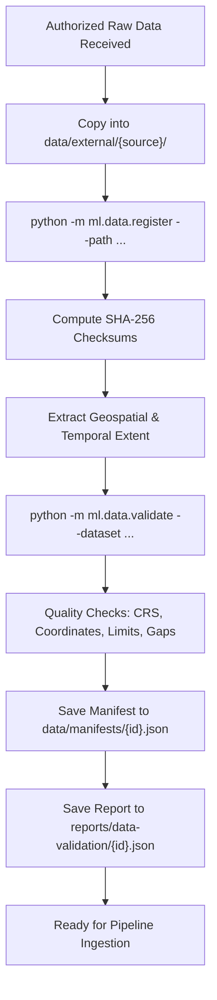

# STORMNET — Phase 8 Meteorological Data Readiness Audit

**Document Identifier:** `AUDIT-PHASE8-READINESS`  
**Problem Statement:** SIH26084 (Convective Scale Nowcasting for Thunderstorms, Hail & Cloudbursts, 0–6 hr)  
**Creation Date:** 2026-09-26  
**Auditor:** Scientific Validation & Architecture Team  
**Status:** FACTUALLY GROUNDED AUDIT & READINESS ASSESSMENT  

---

## 1. Executive Summary

Phase 8 established the **Real Meteorological Data Acquisition Bridge** for STORMNET. This infrastructure provides the provider adapters, local dropzones, SHA-256 manifest system, validation CLI, and scientific experiment gating required to transition from synthetic/development mock data to authentic meteorological observations.

In strict adherence to scientific integrity directives:
- Zero ML models were trained.
- Zero fake radar/satellite/lightning/rain-gauge files were generated.
- No restricted endpoints were scraped.
- The experiment pipeline is now hardware-gated against claiming synthetic results as scientific validation.

---

## 2. Inventory: Datasets Actually Present vs Datasets Missing

### 2.1 Datasets Actually Present in Workspace

| Dataset Path | Source / Provider | Type | Observations / Records | Role in System | Provenance Tier |
| :--- | :--- | :--- | :--- | :--- | :--- |
| `data/samples/radar/dwr_delhi_20260926_1545.json` | IMD Safdarjung (Mock) | Sample JSON | 1 scan (20 cells) | Integration test fixture | `SAMPLE_DATA` |
| `data/samples/satellite/insat_3dr_delhi_20260926_1545.json` | INSAT-3DR TIR1 (Mock) | Sample JSON | 1 frame (4 point obs) | Fusion test fixture | `SAMPLE_DATA` |
| `data/samples/lightning/lln_delhi_20260926_1545.json` | IITM LLN (Mock) | Sample JSON | 5 strikes | Alignment test fixture | `SAMPLE_DATA` |
| `data/samples/aws/aws_delhi_20260926_1545.json` | IMD AWS (Mock) | Sample JSON | 4 stations | Surface test fixture | `SAMPLE_DATA` |
| `data/processed/fused/date=20260926/...parquet` | Fused Multimodal Tensor | Derived Parquet | 1 frame (1,935 cells) | Feature pipeline fixture | `SAMPLE_DATA` |
| `experiments/exp_001_spatiotemporal_unet/...pt` | Synthetic Kinematic Episodes | Synthetic Weights | 4 episodes (60 sequences) | Code path verification | `SYNTHETIC_DATA` |

### 2.2 Datasets Missing / Unmounted

| Target Data Stream | Operational Agency | Required Multi-Year Archive | Missing Format | Impact on Project |
| :--- | :--- | :--- | :--- | :--- |
| **Delhi Doppler Weather Radar** | IMD / MoES | 2021–2025 Monsoons | WMO ODIM_H5 / NetCDF4 | Blocks real Delhi convective model validation |
| **Mumbai Doppler Weather Radar** | IMD / MoES | 2021–2025 Monsoons | WMO ODIM_H5 / NetCDF4 | Blocks coastal domain transfer validation |
| **Chennai Doppler Weather Radar** | IMD / MoES | 2021–2025 Post-Monsoons | WMO ODIM_H5 / NetCDF4 | Blocks cyclone/tropical convective validation |
| **Kolkata Doppler Weather Radar** | IMD / MoES | 2021–2025 Pre-Monsoons | WMO ODIM_H5 / NetCDF4 | Blocks Nor'wester squall-line validation |
| **MOSDAC INSAT-3D/3DR TIR1 & CTT** | ISRO SAC / MOSDAC | 2021–2025 High-Convective Days | HDF5 / NetCDF4 | Blocks satellite radiance assimilation |
| **IITM Total Lightning Stream** | IITM Pune / MoES | 2021–2025 Stroke Archives | CSV / NetCDF4 | Blocks real-world lightning density calibration |
| **IMD AWS / ARG Rainfall Gauges** | IMD Pune / State SDMAs | 2021–2025 Hourly / 15-min Accums | CSV / Hydro-XML | Blocks physical QPE rainfall verification |

---

## 3. Required Access & Institutional Registration

To transition from developmental mode to legitimate scientific validation, the project requires the following authorizations:

1. **IMD National Data Centre (NDC) Pune:**
   - **Access URL:** `https://imdpune.gov.in/ndc_new/`
   - **Required Credentials:** Institutional MoES Research Account / Formal MoU under SIH26084.
   - **Target Data:** Raw volumetric Doppler scans for `DWR-DEL-SAF`, `DWR-MUM-VER`, `DWR-CHE-PRT`, `DWR-KOL-SUB`.
2. **ISRO SAC / MOSDAC Portal:**
   - **Access URL:** `https://www.mosdac.gov.in`
   - **Required Credentials:** Registered Indian Researcher account + OpenSearch API Key.
   - **Target Data:** Level 1B calibrated radiance (`TIR1`, `TIR2`, `WV`) and Level 2B products (`CTT`, `HEM`).
3. **IITM Lightning Location Network:**
   - **Coordinating Facility:** Atmospheric Electricity & Thunderstorm Division, IITM Pune.
   - **Required Credentials:** Inter-institutional scientific data sharing agreement.

---

## 4. Dataset Registration & Validation Workflow

The bridge provides a fully automated, non-destructive workflow for newly supplied data:



---

## 5. Experiment Gating Status

STORMNET now enforces programmatic scientific gating:
- **`DEVELOPMENT_TEST` Mode:**
  - Allowed for software development, regression testing, and CI.
  - Emits safety notice logging that results are unvalidated.
- **`SCIENTIFIC_VALIDATION` Mode:**
  - **HARD GATE:** Throws `ScientificIntegrityError` if dataset provenance is `SYNTHETIC_DATA` or `SAMPLE_DATA`.
  - Rejects attempts to publish, benchmark, or claim nowcasting skill on non-observational data.

---

## 6. Exact Next Step for Obtaining Real Data

1. **Submit Formal Requisition to IMD NDC Pune:**
   - Request 5 severe convective events per target station from the 2024 monsoon season in WMO ODIM_H5 format.
2. **Submit Requisition to ISRO MOSDAC:**
   - Request corresponding 15-minute INSAT-3DR TIR1 and HEM products.
3. **Stage Data in Local Dropzone:**
   - Place files in `data/external/imd_radar/` and `data/external/insat/`.
4. **Execute Registration and Validation:**
   ```bash
   python -m ml.data.register --path data/external/imd_radar/DWR-DEL-SAF/ --dataset-id imd_delhi_2024 --provenance REAL_AUTHORIZED_DATA
   python -m ml.data.validate --dataset imd_delhi_2024
   ```
